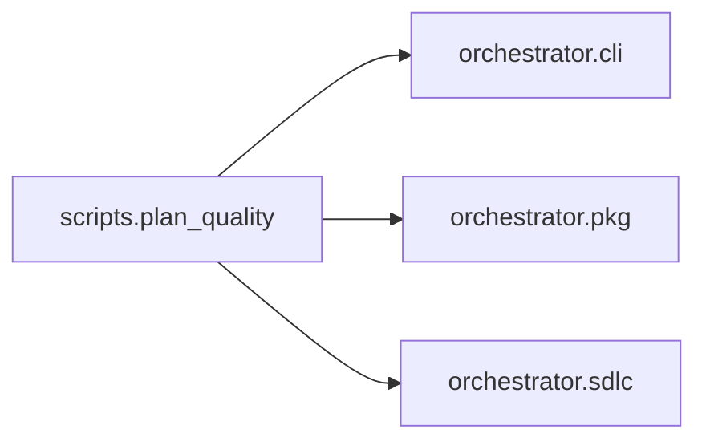

# `scripts.plan_quality`
<!-- generated by `orchestrator understand`; the PKG is source of truth, edits here are advisory -->

[← Episteme](../README.md) · [Architecture](../architecture.md)

**`scripts.plan_quality`** is one of 68 areas in this repo, in the `scripts` zone. It holds 5 modules — 1 types and 29 functions. No other area imports it, and it draws on 3 — nothing else in this repo depends on it. That's the shape of an entry point or a top-level application as much as a leaf utility, so it bounds the outward reach of a change here, not its difficulty.

**In the diagram:** **`scripts.plan_quality`** (this area) · [`orchestrator.cli`](orchestrator.cli.md) · [`orchestrator.pkg`](orchestrator.pkg.md) · [`orchestrator.sdlc`](orchestrator.sdlc.md)

## Modules

- [`scripts.plan_quality.aggregate`](../../scripts/plan_quality/aggregate.py#L1)
- [`scripts.plan_quality.grade`](../../scripts/plan_quality/grade.py#L1)
- [`scripts.plan_quality.make_key`](../../scripts/plan_quality/make_key.py#L1)
- [`scripts.plan_quality.probe_search`](../../scripts/plan_quality/probe_search.py#L1)
- [`scripts.plan_quality.select_set`](../../scripts/plan_quality/select_set.py#L1)

## Depends on

[`orchestrator.cli`](orchestrator.cli.md), [`orchestrator.pkg`](orchestrator.pkg.md), [`orchestrator.sdlc`](orchestrator.sdlc.md)
