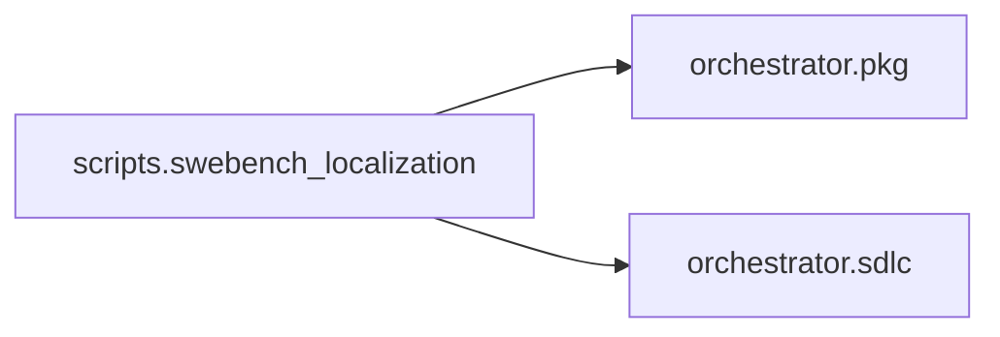

# `scripts.swebench_localization`
<!-- generated by `orchestrator understand`; the PKG is source of truth, edits here are advisory -->

[← Episteme](../README.md) · [Architecture](../architecture.md)

**`scripts.swebench_localization`** is one of 65 areas in this repo, in the `scripts` zone. It holds 6 modules — 0 types and 28 functions. No other area imports it, and it draws on 2 — nothing else in this repo depends on it. That's the shape of an entry point or a top-level application as much as a leaf utility, so it bounds the outward reach of a change here, not its difficulty.

**In the diagram:** **`scripts.swebench_localization`** (this area) · [`orchestrator.pkg`](orchestrator.pkg.md) · [`orchestrator.sdlc`](orchestrator.sdlc.md)

## Modules

- [`scripts.swebench_localization.analyze`](../../scripts/swebench_localization/analyze.py#L1)
- [`scripts.swebench_localization.check_commits`](../../scripts/swebench_localization/check_commits.py#L1)
- [`scripts.swebench_localization.loc_harness`](../../scripts/swebench_localization/loc_harness.py#L1)
- [`scripts.swebench_localization.loc_lib`](../../scripts/swebench_localization/loc_lib.py#L1)
- [`scripts.swebench_localization.loc_worker`](../../scripts/swebench_localization/loc_worker.py#L1)
- [`scripts.swebench_localization.selftest`](../../scripts/swebench_localization/selftest.py#L1)

## Depends on

[`orchestrator.pkg`](orchestrator.pkg.md), [`orchestrator.sdlc`](orchestrator.sdlc.md)
